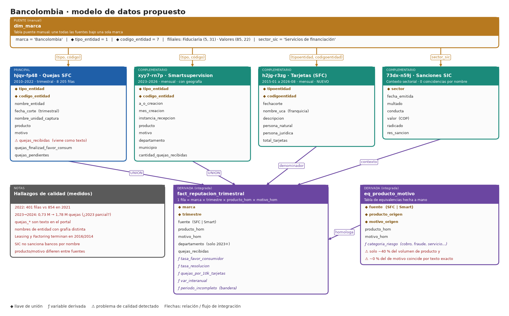

# Opción 1 · Bancolombia

**Tipo:** marca fija (financiera) · **Estado:** reutiliza la carga de datos de Davivienda; solo cambia la marca buscada · **Datos verificados en datos.gov.co el 2026-11-02**

## 1. Idea en una frase

Medir la reputación de Bancolombia con las quejas formales ante la SFC (2010–2026), normalizadas por el tamaño de su base de tarjetas, y usarla como **marca de contraste** de Davivienda.

## 2. Qué tablas se conectan y con qué llave

| Rol | Dataset | Filtro | Llave de unión | Periodo |
|---|---|---|---|---|
| Puente | `dim_marca` (la crea el equipo) | — | `marca` ↔ `(tipo_entidad, codigo_entidad)` | — |
| **Principal** | `hjqv-fp48` Quejas SFC | `(tipo=1, código=7)` y filiales (5,31), (85,22) | `(tipo_entidad, codigo_entidad)` | 2010–2022 (8 205 filas para el banco) |
| Compl. 1 | `xyy7-rn7p` Smartsupervision | mismas llaves | `(tipo_entidad, codigo_entidad)` | 2023–2026 |
| Compl. 2 (nuevo) | `h2jg-r3zg` Tarjetas crédito/débito | `(tipoentidad=1, codigoentidad=7)` | `(tipoentidad, codigoentidad)` + mes | 2015-01 a 2026-08 |
| Compl. 3 | `73dx-n59j` Sanciones SIC | `sector = 'Servicios de financiación'` | `sector` + año (solo contexto) | 2013–2026 |

El nombre `Bancolombia` está solo en el principal; el resto se enlaza por código. En `h2jg-r3zg` las columnas se llaman `tipoentidad`/`codigoentidad` (sin guion bajo).

## 3. Campos a traer

- **`hjqv-fp48`:** `tipo_entidad`, `codigo_entidad`, `nombre_entidad`, `fecha_corte`, `nombre_unidad_captura`, `producto`, `motivo`, `quejas_recibidas`, `quejas_finalizadas`, `quejas_finalizad_favor_consum`, `quejas_finalizad_favor_entidad`, `quejas_pendientes`, `quejas_en_tramite` (las `quejas_*` vienen como texto).
- **`xyy7-rn7p`:** `a_o_creacion`, `mes_creacion`, `tipo_entidad`, `codigo_entidad`, `instancia_recepcion`, `producto`, `motivo`, `departamento`, `municipio`, `cantidad_quejas_recibidas`.
- **`h2jg-r3zg`:** `tipoentidad`, `codigoentidad`, `fechacorte`, `nombre_uca`, `descripcion`, `persona_natural`, `persona_juridica`, `total_tarjetas`. Antes de usarlo hay que fijar qué `descripcion` cuenta (crédito vigente vs. débito) para no sumar tarjetas distintas.
- **`73dx-n59j`:** `fecha_emitida`, `multado`, `conducta`, `valor`, `sector`.

## 4. Cómo resuelve lo que pide el PDF

| Requisito del PDF | Cómo se cubre |
|---|---|
| Datos de datos.gov.co | Los 4 datasets son del portal |
| Datos complementarios + estrategia de integración | 3 complementarios; unión por `(tipo, código)` y `dim_marca`; se unen en `fact_reputacion_trimestral` |
| ≥ 2 preguntas | Ver sección 5 |
| Dispersión, tendencia central, sesgo, contingencia, correlación | Contingencia `producto × motivo`; correlación quejas vs. tarjetas; sesgo del conteo por departamento |
| Calidad (vacíos, inconsistencias, errores) | Hallazgos de la imagen; ver sección 6 |
| Visualización para periódico | Serie trimestral, ranking de motivos, mapa por departamento, comparación con Davivienda |

## 5. Preguntas propuestas

1. **¿Qué productos y motivos concentran las quejas cerradas a favor del consumidor en Bancolombia y cómo se comparan con Davivienda?** (`hjqv-fp48` + `xyy7-rn7p` con la misma metodología.)
2. **¿Las quejas por cada 10 000 tarjetas muestran estacionalidad o focos geográficos que permitan una alerta temprana?** (`xyy7-rn7p` + `h2jg-r3zg`.)

## 6. Calidad: lo que ya se vio

- 2022 trae 401 filas frente a 854 en 2021: corte incompleto, como en Davivienda; hay que marcarlo, no interpolarlo.
- En Smartsupervision las quejas pasan de 730 650 (2023) a 1 777 800 (2024). Hay que confirmar si 2023 es parcial o si cambió la forma de contar antes de hablar de "crecimiento".
- La SIC no sanciona bancos por nombre (0 coincidencias para "Bancolombia"), así que solo sirve como contexto sectorial.
- Leasing Bancolombia (hasta 2016) y Factoring Bancolombia (hasta 2014) quedan fuera con `DESDE = 2019`.
- `producto` y `motivo` no coinciden entre fuentes (medido en Davivienda: ~40 % y ~0 % por texto exacto): requiere tabla `eq_producto_motivo`.

## 7. Esfuerzo y veredicto

- **Esfuerzo: bajo.** La carga de datos de Davivienda es genérica: solo hay que repetirla buscando "bancolombia" (aún no se ha ejecutado) y sumar la carga de `h2jg-r3zg`.
- **Ajuste al PDF:** medio. Es una marca de servicios financieros, no de ropa, tecnología o consumo; la reputación se mide con quejas oficiales, que es justo lo que pide el contexto.
- **Mejor uso:** contraste directo con Davivienda (mismo modelo, dos marcas).
