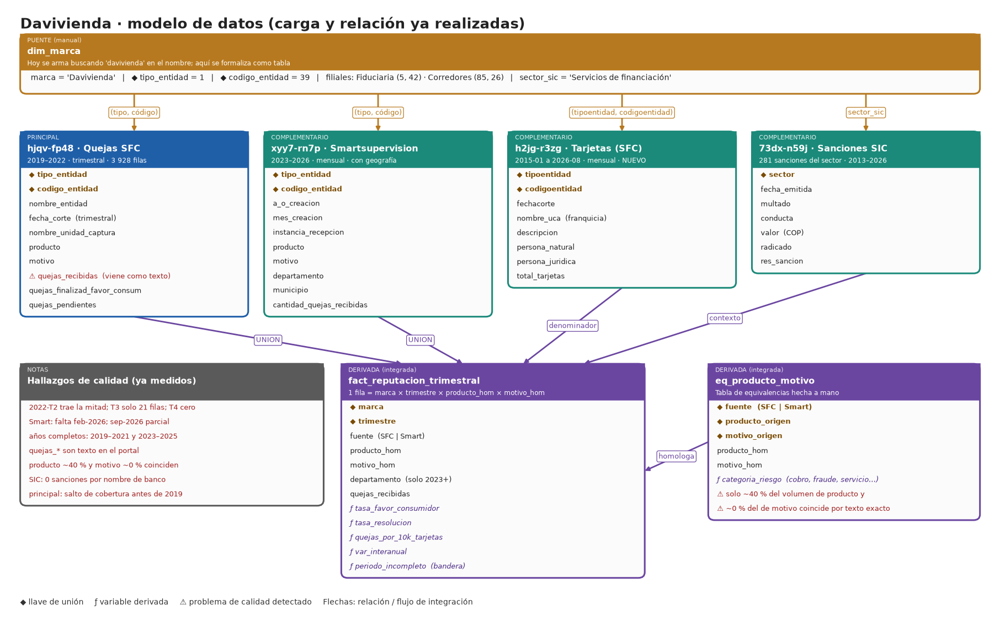

# Opción 2 · Davivienda

**Tipo:** marca fija (financiera) · **Estado:** carga y relación de los datos ya realizadas (avance del equipo) · **Datos verificados en datos.gov.co el 2026-11-02**

## 1. Idea en una frase

Monitorear la reputación de Davivienda con las quejas oficiales ante la SFC (2019–2026), detectando qué motivos y productos terminan a favor del consumidor y cuándo conviene lanzar una alerta temprana.

## 2. Qué tablas se conectan y con qué llave

| Rol | Dataset | Filtro | Llave de unión | Resultado ya obtenido |
|---|---|---|---|---|
| Puente | `dim_marca` | hoy: búsqueda del texto "davivienda" en `nombre_entidad` | `marca` ↔ `(tipo, código)` | Banco (1, 39), Fiduciaria (5, 42), Corredores (85, 26) |
| **Principal** | `hjqv-fp48` Quejas SFC | entidades de la marca, desde 2019 | `(tipo_entidad, codigo_entidad)` | 3 928 filas (2019-03-31 a 2022-12-31) |
| Compl. 1 | `xyy7-rn7p` Smartsupervision | mismas llaves | `(tipo_entidad, codigo_entidad)` | 109 620 filas (2023-01 a 2026-09) |
| Compl. 2 | `73dx-n59j` Sanciones SIC | `sector = 'Servicios de financiación'` | `sector` + año | 281 filas (2013–2026) |
| Compl. 3 (propuesto) | `h2jg-r3zg` Tarjetas | `(1, 39)` | `(tipoentidad, codigoentidad)` + mes | Davivienda presente 2015-01 a 2026-08 |

## 3. Campos a traer

Son los mismos que en Bancolombia (ver [01_Bancolombia.md](01_Bancolombia.md), sección 3) y esas columnas ya se descargan en el avance. Lo único que se añade es `h2jg-r3zg` (`total_tarjetas`) para calcular quejas por 10 000 tarjetas.

## 4. Cómo resuelve lo que pide el PDF

| Requisito del PDF | Estado |
|---|---|
| Exploración y datos complementarios | Hecho: inventario, llaves, cobertura temporal, control de doble conteo |
| ≥ 2 preguntas | Propuestas en la sección 5 de este documento |
| Dispersión, sesgo, contingencia, correlación | Pendiente; ya hay un primer cruce de sanciones vs. quejas |
| Calidad | Parcial: hueco 2022-T2 a T4, febrero de 2026 ausente, septiembre de 2026 parcial |
| Preparación y variables derivadas | Pendiente: tabla de homologación y `fact_reputacion_trimestral` |
| Visualización | Una serie trimestral hecha; faltan 3–5 gráficos para público general |

## 5. Preguntas propuestas

1. **¿Qué motivos y productos concentran las quejas a favor del consumidor y cómo evolucionaron desde 2019?**
2. **¿Existen patrones estacionales o geográficos que permitan anticipar picos de quejas?** (usa departamento y municipio de 2023–2026.)

## 6. Calidad: lo que ya se vio

- Principal: 2022-T2 trae la mitad de lo esperado, 2022-T3 solo 21 filas y 2022-T4 cero. Años completos usables: 2019–2021 y 2023–2025.
- Smartsupervision: falta febrero de 2026 y septiembre de 2026 está parcial.
- El principal tiene un salto de cobertura antes de 2019 (de ~10 000–17 000 a 190 000–350 000 registros por año en todo el dataset); por eso se filtra desde 2019.
- Solo ~40 % del volumen de `producto` y ~0 % del de `motivo` coincide por texto exacto entre las dos fuentes de quejas.
- Las dos fuentes miden instancias distintas: para comparar se usa solo *Entidad vigilada*.

## 7. Esfuerzo y veredicto

- **Esfuerzo: el más bajo de las cinco.** La carga y la relación de datos ya existen; falta EDA, homologación, derivadas, visualización y reporte.
- **Ajuste al PDF:** medio (financiera, no de ropa/tecnología/consumo) pero con la mejor evidencia: volumen alto (más de 100 000 filas) y desenlace de la queja.
- **Riesgo principal:** el hueco 2022 obliga a trabajar con dos tramos de serie separados.
