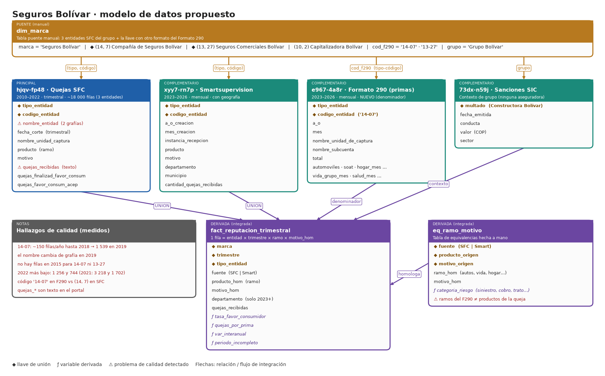

# Opción 3 · Seguros Bolívar

**Tipo:** marca propuesta (aseguradora, Grupo Bolívar) · **Estado:** nueva; reutiliza la carga de quejas SFC de Davivienda y añade un dataset de primas · **Datos verificados en datos.gov.co el 2026-11-02**

## 1. Idea en una frase

Medir la reputación de Seguros Bolívar con las quejas ante la SFC de sus aseguradoras, normalizadas por el volumen de primas, para saber en qué ramos y regiones aparece el malestar del asegurado (por ejemplo, el rechazo de siniestros).

## 2. Qué tablas se conectan y con qué llave

| Rol | Dataset | Filtro | Llave de unión | Periodo |
|---|---|---|---|---|
| Puente | `dim_marca` | 3 entidades del grupo + código del Formato 290 | `marca` ↔ `(tipo, código)` ↔ `'14-07'` | — |
| **Principal** | `hjqv-fp48` Quejas SFC | `(14, 7)` Compañía de Seguros Bolívar, `(13, 27)` Seguros Comerciales Bolívar, `(10, 2)` Capitalizadora Bolívar | `(tipo_entidad, codigo_entidad)` | 2010–2022 (~18 000 filas en las tres) |
| Compl. 1 | `xyy7-rn7p` Smartsupervision | mismas llaves | `(tipo_entidad, codigo_entidad)` | 2023–2026 |
| Compl. 2 (nuevo) | `e967-4a8r` Formato 290, primas por ramo | `nombre_entidad` de Bolívar | `codigo_entidad = 'tipo-código'` (ej. `14-07`) + año + mes | 2023–2026 |
| Compl. 3 (opcional) | `73dx-n59j` Sanciones SIC | `multado like 'CONSTRUCTORA BOLIVAR%'` | solo contexto de grupo | 1 sanción |

**Atención con la llave:** el principal y Smartsupervision traen `tipo_entidad` y `codigo_entidad` como números separados, pero el Formato 290 trae `codigo_entidad` como texto `'14-07'`. Hay que partirlo y convertirlo, o usar `cod_f290` en `dim_marca`.

## 3. Campos a traer

- **`hjqv-fp48`:** los mismos de Bancolombia, más `quejas_favor_consum_acep` y `quejas_favor_consum_noacep` (si la aseguradora aceptó el fallo; útil en seguros). `producto` aquí es el ramo.
- **`xyy7-rn7p`:** igual que en Bancolombia.
- **`e967-4a8r`:** `a_o`, `mes`, `tipo_entidad`, `codigo_entidad`, `nombre_unidad_de_captura`, `nombre_subcuenta`, `total` y las columnas por ramo (`automoviles`, `soat`, `hogar_mes`, `vida_grupo_mes`, `salud_mes`, …). Primero hay que escoger la `nombre_unidad_de_captura` que represente primas emitidas y confirmar la unidad monetaria en la ficha del dataset (no verificada).
- **`73dx-n59j`:** `fecha_emitida`, `multado`, `conducta`, `valor`, `sector`.

## 4. Cómo resuelve lo que pide el PDF

| Requisito del PDF | Cómo se cubre |
|---|---|
| Datos complementarios con justificación | Las primas dan un denominador de negocio: no es lo mismo 10 000 quejas con mucha prima que con poca |
| Integración | Unión por `(tipo, código)` y por `cod_f290`; tabla integrada trimestral |
| Calidad | Cambio de grafía del nombre en 2019, año 2015 ausente, salto de cobertura |
| Variables derivadas | `tasa_favor_consumidor`, `quejas_por_prima`, `var_interanual`, `periodo_incompleto` |
| Visualización | Serie por entidad, ranking de ramos y motivos, mapa por departamento |

## 5. Preguntas propuestas

1. **¿Qué ramos y motivos concentran las quejas falladas a favor del asegurado y cómo cambia la relación quejas/prima entre 2023 y 2026?**
2. **¿En qué departamentos y ramos crece de forma sostenida el número de quejas?** Señal inicial en los datos: Compañía de Seguros Bolívar pasa de 7 281 quejas (2023) a 9 448 (2024) y 11 278 (2025), mientras Seguros Comerciales Bolívar baja de 4 769 a 4 259 y 3 977.

## 6. Calidad: lo que ya se vio

- `(14, 7)` tiene ~100–170 filas por año hasta 2018, 1 539 en 2019 y 3 260 en 2020. El salto coincide con el del dataset completo y debe tratarse como cambio de cobertura, no de comportamiento.
- El nombre de la entidad cambia de grafía en 2019 (`Compañía De Seguros Bolivar S.A.` → `COMPAÑÍA DE SEGUROS BOLIVAR S.A.`): filtrar por código, no por nombre.
- No hay filas de 2015 para `(14, 7)` ni `(13, 27)`.
- 2022 parece incompleto (1 256 y 744 filas frente a 3 218 y 1 702 en 2021).
- La SIC no multa a ninguna aseguradora del grupo por nombre; la única coincidencia del grupo es Constructora Bolívar (1 sanción de ~$1 306 M COP), que sirve solo como contexto.
- Los ramos del Formato 290 no son idénticos a los `producto` de las quejas: hace falta `eq_ramo_motivo`.

## 7. Esfuerzo y veredicto

- **Esfuerzo: medio.** La descarga de quejas es la misma que la de Davivienda; hay que añadir el Formato 290 y resolver la llave `'14-07'`.
- **Ajuste al PDF:** medio-alto. Es una marca de consumo masivo (seguros de autos, hogar, vida) y la queja de un asegurado es un buen proxy de mal servicio. No es ropa ni producto tecnológico.
- **Ventaja:** el denominador (primas) permite una métrica de reputación más justa que el conteo bruto.
- **Riesgo:** depende de entender bien el Formato 290; una mala elección de `nombre_unidad_de_captura` invalida la tasa.
