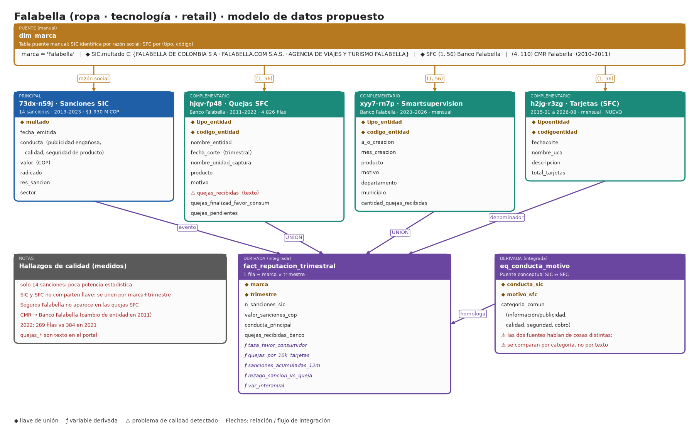

# Opción 4 · Falabella (ropa · tecnología · retail)

**Tipo:** alternativa pensada para ajustarse a la letra del PDF (marca de ropa y productos tecnológicos) · **Datos verificados en datos.gov.co el 2026-11-02**

## 1. Por qué encaja con el PDF

El enunciado pide "una marca de ropa, de un producto tecnológico, de consumo" y detectar "cualquier error o mal servicio". Falabella vende ropa, electrónicos y hogar, y la SIC la sanciona **por nombre** (algo que no ocurre con los bancos) por conductas que son exactamente mal servicio: publicidad engañosa, calidad y seguridad de producto.

## 2. Qué tablas se conectan y con qué llave

| Rol | Dataset | Filtro | Llave de unión | Datos verificados |
|---|---|---|---|---|
| Puente | `dim_marca` | razones sociales SIC + código SFC | `marca` ↔ `multado` ↔ `(tipo, código)` | — |
| **Principal** | `73dx-n59j` Sanciones SIC | `multado like '%FALABELLA%'` | razón social (3 variantes) | 14 sanciones, 2013-01 a 2023-06, $1 930 M COP |
| Compl. 1 | `hjqv-fp48` Quejas SFC | `(1, 56)` Banco Falabella | `(tipo_entidad, codigo_entidad)` | 4 826 filas, 2011–2022 |
| Compl. 2 | `xyy7-rn7p` Smartsupervision | `(1, 56)` | `(tipo_entidad, codigo_entidad)` | 41 778 (2023), 38 420 (2024), 32 863 (2025) quejas |
| Compl. 3 | `h2jg-r3zg` Tarjetas | `(1, 56)` | `(tipoentidad, codigoentidad)` + mes | 2015-01 a 2026-08 |

**Razones sociales en la SIC:** `FALABELLA DE COLOMBIA S A` (la mayoría), `FALABELLA.COM S.A.S.` y `AGENCIA DE VIAJES Y TURISMO FALABELLA S A S.`. Conductas: información y publicidad engañosa (5), seguridad de producto (2), calidad (2 + 1 con IVA) y publicidad engañosa y protección contractual (2).

**Integración:** SIC y SFC **no comparten llave**. Se unen por la marca (`dim_marca`) y por el eje temporal (trimestre). Esto es una decisión de diseño, no un join de base de datos, y debe justificarse en el reporte.

## 3. Campos a traer

- **`73dx-n59j`:** `radicado`, `res_sancion`, `fecha_emitida`, `multado`, `valor`, `conducta`, `sector`.
- **`hjqv-fp48` y `xyy7-rn7p`:** igual que en Bancolombia (ver [01_Bancolombia.md](01_Bancolombia.md)).
- **`h2jg-r3zg`:** `tipoentidad`, `codigoentidad`, `fechacorte`, `nombre_uca`, `descripcion`, `total_tarjetas`.

## 4. Cómo resuelve lo que pide el PDF

| Requisito | Cómo se cubre |
|---|---|
| Marca de ropa / tecnología / consumo | Falabella: retail con ropa y electrónicos |
| "Error o mal servicio" | Sanciones SIC por publicidad engañosa, calidad y seguridad de producto |
| Complementarios e integración | Banco Falabella (quejas y tarjetas) + eje temporal común |
| Preguntas creativas | Ver sección 5: la relación entre sanción y queja es poco habitual |
| Visualización de periódico | Línea de tiempo de sanciones sobre la curva de quejas |

## 5. Preguntas propuestas

1. **¿Qué conductas generan las sanciones a Falabella y se anticipan en las quejas del banco con un rezago medible?**
2. **¿Por qué bajan las quejas del Banco Falabella (41 778 en 2023 a 32 863 en 2025) y qué motivos explican la caída?** (Cruce con tarjetas vigentes para ver si es una mejora real o un efecto de tamaño.)

## 6. Calidad y límites (leer antes de elegirla)

- **Solo 14 sanciones.** Sirven para describir y narrar, no para correlaciones sólidas. La potencia estadística está del lado del banco.
- El volumen de quejas del banco en 2011–2022 es bajo (entre 261 y 484 filas por año); 2022 trae 289 frente a 384 en 2021.
- La parte "ropa y tecnología" de Falabella solo aparece vía SIC; las quejas SFC son de su brazo financiero. Hay que decirlo con claridad para no sobrevender.
- No aparece "Seguros Falabella" en las quejas SFC. CMR Falabella (4, 110) existe hasta 2011-03 y Banco Falabella desde 2011-06: trátalas como continuidad de marca, pero verifica el hecho en la ficha de la SFC.
- Las dos fuentes de quejas usan nomenclaturas distintas de `producto` y `motivo`.

## 7. Esfuerzo y veredicto

- **Esfuerzo: medio.** Descarga fácil (misma técnica que Davivienda), pero la unión SIC ↔ SFC es conceptual y exige una tabla `eq_conducta_motivo`.
- **Ajuste literal al PDF: alto.** **Potencia de datos: baja-media.**
- **Mejor uso:** si el equipo valora presentar una marca reconocible del consumidor final y acepta una narrativa basada en eventos (sanciones) más que en grandes volúmenes.
