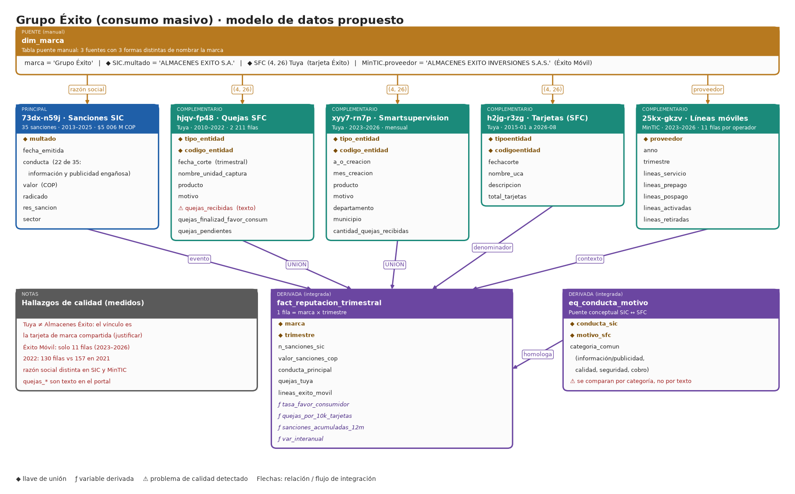

# Opción 5 · Grupo Éxito (consumo masivo)

**Tipo:** alternativa pensada para ajustarse a la letra del PDF (marca de consumo masivo, con un brazo tecnológico) · **Datos verificados en datos.gov.co el 2026-11-02**

## 1. Por qué encaja con el PDF

"Marca de consumo" y "error o mal servicio" son literalmente el caso de Almacenes Éxito: la SIC la ha sancionado **35 veces** (2013–2025, ≈ $5 006 M COP), 22 de ellas por información y publicidad engañosa. Además hay quejas formales de su tarjeta (Tuya) y datos del operador Éxito Móvil, que aporta el componente tecnológico.

## 2. Qué tablas se conectan y con qué llave

| Rol | Dataset | Filtro | Llave de unión | Datos verificados |
|---|---|---|---|---|
| Puente | `dim_marca` | 3 formas de nombrar la marca | `marca` ↔ `multado` ↔ `(tipo, código)` ↔ `proveedor` | — |
| **Principal** | `73dx-n59j` Sanciones SIC | `multado like '%ALMACENES EXITO%'` | razón social | 35 sanciones, 2013-01 a 2025-07, $5 006 M COP |
| Compl. 1 | `hjqv-fp48` Quejas SFC | `(4, 26)` Tuya | `(tipo_entidad, codigo_entidad)` | 2 211 filas, 2010–2022 |
| Compl. 2 | `xyy7-rn7p` Smartsupervision | `(4, 26)` | `(tipo_entidad, codigo_entidad)` | 10 592 (2023), 8 390 (2024), 8 789 (2025) quejas |
| Compl. 3 | `h2jg-r3zg` Tarjetas | `(4, 26)` | `(tipoentidad, codigoentidad)` + mes | 2015-01 a 2026-08 |
| Compl. 4 | `25kx-gkzv` Líneas móviles (MinTIC) | `proveedor = 'ALMACENES EXITO INVERSIONES S.A.S.'` | `proveedor` + año + trimestre | 11 filas, 2023–2026; mismo dataset trae a Comcel y Colombia Telecomunicaciones |

**Dos vínculos que hay que justificar en el reporte:**
- Tuya no es "Almacenes Éxito": es el emisor de la tarjeta de marca compartida. Debe afirmarse como supuesto de marca y confirmarse con una fuente oficial.
- La razón social cambia entre SIC (`ALMACENES EXITO S.A.`) y MinTIC (`ALMACENES EXITO INVERSIONES S.A.S.`); `dim_marca` resuelve esa diferencia.

## 3. Campos a traer

- **`73dx-n59j`:** `radicado`, `res_sancion`, `fecha_emitida`, `multado`, `valor`, `conducta`, `sector`.
- **`hjqv-fp48` y `xyy7-rn7p`:** igual que en Bancolombia (ver [01_Bancolombia.md](01_Bancolombia.md)).
- **`h2jg-r3zg`:** `tipoentidad`, `codigoentidad`, `fechacorte`, `nombre_uca`, `descripcion`, `total_tarjetas`.
- **`25kx-gkzv`:** `anno`, `trimestre`, `proveedor`, `lineas_servicio`, `lineas_prepago`, `lineas_pospago`, `lineas_activadas`, `lineas_retiradas`.

## 4. Cómo resuelve lo que pide el PDF

| Requisito | Cómo se cubre |
|---|---|
| Marca de consumo / tecnología | Éxito (retail y alimentos) + Éxito Móvil |
| "Error o mal servicio" | 35 sanciones con tipo de conducta y valor |
| Complementarios e integración | Tuya (quejas, tarjetas) y líneas móviles; `dim_marca` + eje trimestral |
| Sesgo, dispersión, contingencia | Valor de multas (muy sesgado a la derecha), conducta × año, motivo × producto |
| Visualización de periódico | Línea de tiempo de sanciones y su valor; quejas de la tarjeta por 10 000 tarjetas |

## 5. Preguntas propuestas

1. **¿Por qué se sanciona a Éxito y cómo cambió el tipo y el valor de las sanciones entre 2013 y 2025?** (Conductas, valor, sesgo de la distribución.)
2. **¿Las quejas de la tarjeta Éxito (Tuya) por cada 10 000 tarjetas están al alza o a la baja, y qué motivos las explican?** (Hay una caída de 10 592 a 8 390 entre 2023 y 2024 y un ligero repunte a 8 789 en 2025.)

## 6. Calidad y límites (leer antes de elegirla)

- La unión SIC ↔ SFC es conceptual (no hay llave común): se hace por marca y trimestre. Es una limitación que hay que declarar.
- Tuya no cubre a toda la marca Éxito. La parte de supermercados y almacenes solo se ve a través de las sanciones.
- Éxito Móvil aporta solo 11 filas (2023–2026): sirve como contexto de tamaño, no como análisis.
- 2022 en Tuya trae 130 filas frente a 157 en 2021.
- Las dos fuentes de quejas usan nomenclaturas distintas de `producto` y `motivo`.
- Sin un valor de multa deflactado, comparar 2013 con 2025 engaña; hay que decidir si se ajusta por inflación (por ejemplo, con el IPC de DANE, que habría que cargar).

## 7. Esfuerzo y veredicto

- **Esfuerzo: medio.** Cinco fuentes, pero tres reutilizan la carga de quejas ya hecha para Davivienda.
- **Ajuste literal al PDF: alto.** **Potencia de datos: media** (35 sanciones + ~30 000 quejas de la tarjeta).
- **Mejor uso:** es la alternativa con más volumen entre las dos que se ajustan al enunciado, y la narrativa del pitch ("Éxito paga millones por publicidad engañosa") es fácil de vender a un patrocinador.
